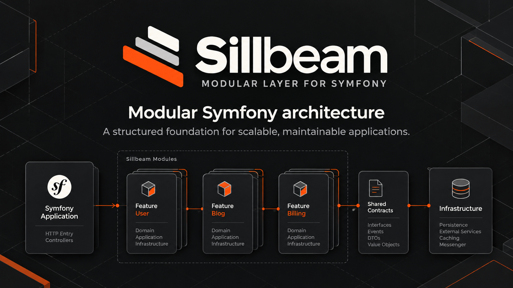

<a id="readme-top"></a>

<div align="center">
  
</div>

<div align="center">

[![Composer][composer-shield]][composer-url]
[![CI][ci-shield]][ci-url]
[![PHP][php-shield]](#requirements)
[![Symfony][symfony-shield]](#requirements)
[![Status][status-shield]](#install-with-composer)
[![License][license-shield]](LICENSE)

**A modular architecture layer for scalable, maintainable Symfony applications.**

[Website](https://getsillbeam.websign.de/) · [Quick start](#quick-start) · [Documentation](docs/README.md) · [Release notes](docs/releases/0.3.0.md) · [Report an issue][issues-url]

</div>

Sillbeam Core extends Symfony with explicit module boundaries, declared dependencies and optional Projects. It discovers your architecture, validates its dependency graph and checks static code references when Symfony builds the container. Symfony continues to handle services, routing and the application runtime.

Use it in an existing Symfony application or build a modular monolith from the start. Doctrine integration is optional, and the standard Symfony kernel is sufficient. `SillbeamKernel` provides a convenient alternative.

## Modular architecture

| Capability | Scope |
| :--- | :--- |
| **Feature modules** | Organize code through `#[SillbeamModule]` descriptors and declare direct dependencies. |
| **Architecture checks** | Detect cycles, missing dependencies, invalid boundaries and undeclared static cross-module references during container compilation. |
| **Symfony services** | Discover module services through native autowiring, autoconfiguration and Symfony service attributes. |
| **Module routing** | Import controller routes from active modules and Projects through one route-loader entry. |
| **Optional Projects** | Compose multiple surfaces with shared and private modules, including host-based routing. |
| **Optional Doctrine integration** | Register entity mappings from active modules and Projects when DoctrineBundle is installed. |
| **Flexible discovery** | Configure multiple roots, namespaces, exclusions and alternative controller or entity directories. |
| **Architecture diagnostics** | Inspect the catalog, activation reasons and dependency evidence as text or JSON. |

Modules normally live in `src/Module`; Projects live in `src/Project`. These defaults can be [configured](docs/reference/configuration.md). Each descriptor owns its directory and descendants. Descriptor filenames are flexible, but must match their PSR-4 class names.

## Quick start

### Requirements

- **PHP 8.4 or newer** and Composer.
- **Symfony 7.4 or 8.x** in the consuming application.
- **DoctrineBundle**, only if you want automatic Doctrine entity mappings.

The current CI targets PHP 8.4/8.5 with Symfony 7.4/8.1. The [independent v0.2.0 acceptance](docs/development/installation-acceptance-2026-10-25/INSTALLATIONS-ABNAHME.md) records its exact tested versions and historical limitations; the [F01/F02 follow-up](docs/development/doctor-f01-f02-verification-2026-10-25/README.md) documents the subsequent Doctor corrections. The original report is not an unconditional release approval. Earlier compatibility snapshots describe their own historical scope.

### Install with Composer

From the root of a fresh or existing Symfony application:

```bash
composer require websign-dev/sillbeam-core
```

Composer selects an available compatible release. This checkout prepares **v0.3.0**;
a `:^0.3.0` constraint requires that release to be published. See
[release status](#release-status). Package installation and Flex recipe availability
are separate. The [existing Flex recipe](flex-recipe/README.md) registers the bundle
and one route import when installed through your configured endpoint; it does not
edit `bin/console` or `services.yaml`. Public Contrib approval is a separate step.

Before running Doctor, select the Core Application in your **existing** `bin/console`:

```diff
-use Symfony\Bundle\FrameworkBundle\Console\Application;
+use Sillbeam\Core\Console\Application;
```

Keep the bootstrap, Runtime callback, import aliases and kernel. This deliberate
manual edit makes Doctor available even without the bundle or a working container.
Then run:

```bash
php bin/console sillbeam:doctor
```

Review its concrete next steps:

- Enable `Sillbeam\Core\SillbeamCoreBundle::class => ['all' => true]` in the existing
  bundle array if missing; preserve the other bundles and environment flags.
- Keep exactly one `sillbeam: { resource: ., type: sillbeam }` import, normally in
  `config/routes/sillbeam.yaml`. Do not duplicate a Flex-provided import.
- Append complete Module/Project discovery areas to broad native service imports'
  existing exclusions. Keep other exclusions and explicit services. For the usual
  `App\` import of `../src/`, an exclusion can be
  `../src/{DependencyInjection,Entity,Kernel.php,Module,Project}`; use actual paths
  for custom roots.

Neither Doctor nor the recipe overwrites those native files. Dynamic configuration
remains `not verified`; review it manually. A green Doctor result confirms static
evidence only. No `config/packages/sillbeam.yaml` is required for the defaults.
The [installation guide](docs/guides/getting-started.md) includes exact edits,
boot-failure recovery and the optional Doctrine setup.

```bash
php bin/console sillbeam:doctor
php bin/console sillbeam:architecture
php bin/console sillbeam:make:module Hello
```

Add the guide's [Greeting service and HelloController](docs/guides/getting-started.md#4-create-the-first-module)
to the new module. Then verify it:

```bash
php bin/console cache:clear
php bin/console sillbeam:architecture
php bin/console debug:router hello
```

A request to `/hello` through your existing development server returns
`Hello from Sillbeam`. The descriptor command alone creates no route. Existing
Projects must select the shared Hello module first; Project routes have prefixed
names and optional host filters. Ordinary make/container commands require a usable
architecture; the adapter keeps Doctor and reporting available before boot.

## Modules and Projects

Declare another module in `dependencies` whenever your module directly references its classes. Sillbeam checks declarations and observed static references, and reports invalid access with file and line information. Unused imports do not create dependencies. Dynamic class names, PHPDoc and string service IDs are outside this analysis.

Without Projects, all enabled shared modules are active. With Projects, each Project selects shared modules and automatically includes its enabled private modules; dependencies complete its graph. Unassigned shared modules remain in the catalog but contribute no automatic services, routes or entity mappings.

| Application layout | Use case |
| :--- | :--- |
| **Symfony only** | Keep a conventional Symfony application with no module or Project descriptors. |
| **Modules only** | Structure one application around enabled shared feature modules. |
| **Project only** | Use direct Project services, controllers and entities without modules. |
| **Single Project** | Group a surface and its private modules without requiring host configuration. |
| **Multiple Projects** | Compose surfaces with distinct hosts and shared or private modules. |
| **Hybrid** | Combine conventional Symfony code with module and Project directories. |

Projects share the container, database and event system. They provide architectural ownership and routing composition, rather than process or tenant isolation. Global subscribers and handlers are not automatically restricted to a Project's host.

Read the [module guide](docs/guides/modules.md) and [Project guide](docs/guides/projects.md) for dependency rules, activation and routing.

## Everyday workflow

Run these commands from your Symfony application's root:

| Command | Purpose |
| :--- | :--- |
| `php bin/console sillbeam:architecture` | Explain architecture findings and contextual next steps. |
| `php bin/console sillbeam:graph` | Write `architecture.svg` directly in PHP (no extra tools); use `--module=Billing` for direct relationships or `--format=mermaid` for raw source ([reference](docs/reference/mermaid-graph.md)). |
| `php bin/console sillbeam:inspect:module Billing` | Inspect one module, its configuration, activation and dependency evidence ([reference](docs/reference/module-inspection.md)). |
| `php bin/console sillbeam:doctor` | Inspect static installation evidence; review unverified checks manually. |
| `php bin/console sillbeam:doctor --format=json` | Export the [versioned Doctor result](docs/reference/doctor-json.md) with stable check IDs. |
| `php bin/console sillbeam:architecture --format=json` | Export the architecture catalog and dependency evidence. |
| `php bin/console sillbeam:report` | Write a standalone Markdown architecture report. |
| `php bin/console sillbeam:about` | Show application, runtime and module information. |
| `php bin/console debug:container` | Inspect Symfony service registration. |
| `php bin/console debug:router` | Inspect imported application routes. |
| `php bin/console doctrine:mapping:info` | Inspect entity mappings when DoctrineBundle is installed. |

Architecture errors block ordinary container-backed commands. With `Sillbeam\Core\Console\Application` selected in the existing bootstrap, the exact architecture, report, module-inspection, graph and Doctor commands remain available before container compilation. Doctor recognizes conventional Runtime callbacks and stock Symfony 7.4/8.1 kernels statically; dynamic or ambiguous configuration remains `not verified`. Unknown routing does not hide independently proven service-import conflicts. The regular Symfony entry point can write cache files before Doctor runs. See the [CLI reference](docs/reference/cli.md) and [troubleshooting guide](docs/operations/troubleshooting.md).

## Documentation

| Guide | Contents |
| :--- | :--- |
| [Documentation overview](docs/README.md) | Guide index and starting points. |
| [Getting started](docs/guides/getting-started.md) | Installation, descriptors and native Symfony integration. |
| [Architecture](docs/architecture/overview.md) | Discovery, ownership, compilation and dependency boundaries. |
| [Modules](docs/guides/modules.md) | Descriptors, dependencies and activation rules. |
| [Projects](docs/guides/projects.md) | Shared and private modules, hosts and request context. |
| [Configuration](docs/reference/configuration.md) | Discovery roots, exclusions and integration settings. |
| [Public API](docs/reference/public-api.md) | Attributes, registries and runtime interfaces. |
| [English API JSON](docs/reference/phpdoc-json.md) | Run `composer docs:export-json` for the manually translated website artifact. |
| [Doctrine](docs/modules/doctrine.md) | Optional entity mapping integration. |
| [Migration](docs/migration/modular-monolith.md) | Breaking changes and replacing the former Foundation features. |
| [Testing](docs/development/testing.md) | Repository checks and integration coverage. |
| [Test applications](docs/development/test-apps.md) | Example layouts and the isolated consumer application. |

## Release status

Sillbeam Core **v0.3.0 is prepared for release acceptance**, based on v0.2.0. It adds English PHPDoc/API documentation, clearer installation guidance, Doctor JSON v1, targeted module inspection and Mermaid graph export. See the [changelog](CHANGELOG.md), [release notes](docs/releases/0.3.0.md), [upgrade guide](docs/migration/0.3.0.md) and [acceptance report](docs/development/release-0.3.0-acceptance/README.md).

This checkout does not establish publication or final approval. A stable `:^0.3.0` installation requires the matching approved tag/version to become available through Packagist. Composer derives release versions from Git tags; no fixed package `version` field is added. `main` and the current `dev-0.3.x` branch alias to `0.3.x-dev`.

The compatible [Flex recipe](flex-recipe/README.md) remains under `0.2/`. Its public availability is separate from the package release; manual integration remains supported. No tag, push, Packagist publication or Recipes Contrib submission is performed by the acceptance checks. Final release authorization belongs to the maintainer.

The [v0.2 migration guide](docs/migration/0.2.0.md) remains the historical guide for the earlier package/namespace rename. Historical reports retain their original findings and scope.

For reports even when the service container cannot compile, use `Sillbeam\Core\Console\Application` in the existing `bin/console` bootstrap. See [CLI reporting](docs/reference/cli.md) for setup, JSON schema and exit codes.

## Scope and migration

Sillbeam focuses on module architecture within Symfony. Services, HTTP handling and runtime behavior use Symfony's existing mechanisms. Applications supply their own business functionality and infrastructure integrations.

The former Foundation layer—including API, Security, User, entity bases, stores and infrastructure helpers—has been removed. This is a **breaking change**: replace existing usage according to the [migration guide](docs/migration/modular-monolith.md) before updating. Strata remains a future idea and is not a dependency.

## Development & support

From the Sillbeam repository root:

```bash
composer install
composer validate --strict
composer test
composer analyse
composer architecture
composer cs:check
composer test:consumer
composer test:flex-recipe
SILLBEAM_TEST_DOCTRINE=1 composer test:flex-recipe
```

The example applications cover six operating variants. The isolated consumer lives under `apps/test-app`; its setup is described in the [test-app guide](docs/development/test-apps.md).

Read [Contributing](CONTRIBUTING.md) for development setup, required checks and pull request guidance, [Support](SUPPORT.md) for assistance and [Security](SECURITY.md) for private vulnerability reporting.

When [reporting an issue][issues-url], include your PHP and Symfony versions, relevant Sillbeam configuration, the application layout and diagnostic output. Remove credentials from shared output.

## License

Sillbeam is licensed under the [MIT License](LICENSE).

---

<div align="center">

[Documentation](docs/README.md) · [Report an issue][issues-url] · [Back to top](#readme-top)

</div>

<!-- Navigation -->
[issues-url]: https://github.com/WebSign-Dev/sillbeam-core/issues
[releases-url]: https://github.com/WebSign-Dev/sillbeam-core/releases
[composer-url]: https://packagist.org/packages/websign-dev/sillbeam-core
[ci-url]: https://github.com/WebSign-Dev/sillbeam-core/actions/workflows/ci.yml

<!-- Badges: repository CI and requirements from composer.json -->
[composer-shield]: https://img.shields.io/packagist/v/websign-dev/sillbeam-core?label=Composer&logo=composer&logoColor=white
[ci-shield]: https://github.com/WebSign-Dev/sillbeam-core/actions/workflows/ci.yml/badge.svg
[php-shield]: https://img.shields.io/badge/PHP-%E2%89%A5%208.4-777bb4?logo=php&logoColor=white
[symfony-shield]: https://img.shields.io/badge/Symfony-7.4%20%7C%208.x-000000?logo=symfony&logoColor=white
[status-shield]: https://img.shields.io/badge/status-v0.3.0_candidate-57606a
[license-shield]: https://img.shields.io/badge/license-MIT-57606a
