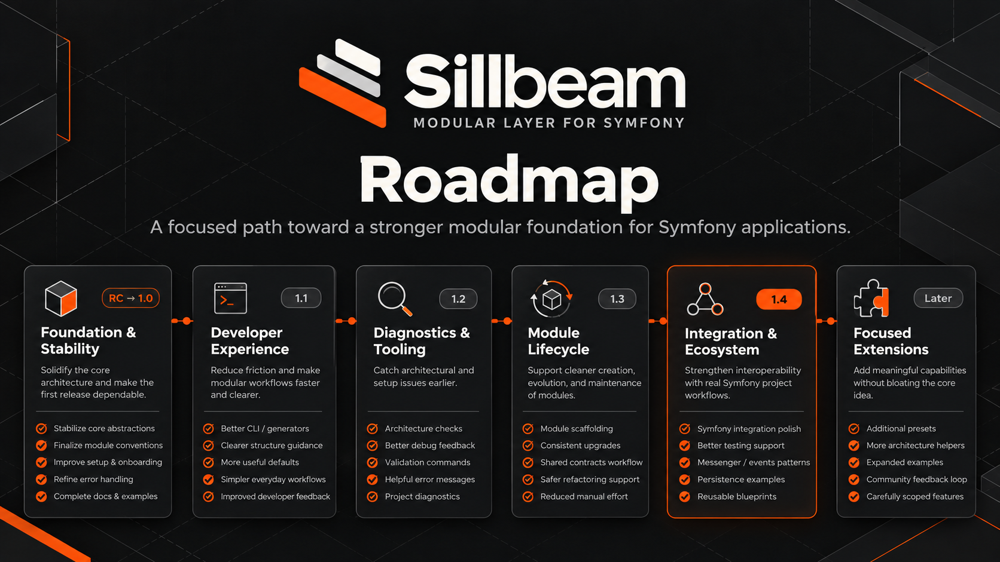

<a id="readme-top"></a>

<div align="center">
  
</div>

<div align="center">

[![CI][ci-shield]][ci-url]
[![PHP][php-shield]](#requirements)
[![Symfony][symfony-shield]](#requirements)
[![Status][status-shield]](#install-from-a-checkout)
[![License][license-shield]](#license)

**A modular architecture layer for scalable, maintainable Symfony applications.**

[Quick start](#quick-start) · [Documentation](docs/README.md) · [Roadmap](#roadmap) · [Report an issue][issues-url]

</div>

Sillbeam extends Symfony with explicit module boundaries, declared dependencies and optional Projects. It discovers your architecture, validates its dependency graph and checks static code references when Symfony builds the container. Symfony continues to handle services, routing and the application runtime.

Use it in an existing Symfony application or build a modular monolith from the start. Doctrine integration is optional, and the standard Symfony kernel is sufficient. `SillbeamKernel` provides a convenient alternative.

## Modular architecture

| Capability | Scope |
| :--- | :--- |
| **Feature modules** | Organize code through `#[SillbeamModule]` descriptors and declare direct dependencies. |
| **Architecture checks** | Detect cycles, missing dependencies, invalid boundaries and undeclared static cross-module references during container compilation. |
| **Symfony services** | Discover module services through native autowiring, autoconfiguration and Symfony service attributes. |
| **Module routing** | Import controller routes from active modules and Projects through one route-loader entry. |
| **Optional Projects** | Compose multiple surfaces with shared and private modules, including host-based routing. |
| **Optional Doctrine integration** | Register entity mappings from active modules and Projects when DoctrineBundle is installed. |
| **Flexible discovery** | Configure multiple roots, namespaces, exclusions and alternative controller or entity directories. |
| **Architecture diagnostics** | Inspect the catalog, activation reasons and dependency evidence as text or JSON. |

Modules normally live in `src/Module`; Projects live in `src/Project`. These defaults can be [configured](docs/reference/configuration.md). Each descriptor owns its directory and descendants. Descriptor filenames are flexible, but must match their PSR-4 class names.

## Quick start

### Requirements

- **PHP 8.4 or newer** and Composer.
- **Symfony 7.4 or 8.x** in the consuming application.
- **DoctrineBundle**, only if you want automatic Doctrine entity mappings.

### Install from a checkout

Sillbeam is currently on the **`0.1.x` development line**. The example below uses a local Composer path repository and does not depend on a published stable package or Flex recipe.

Clone this repository, then run the Composer commands from your Symfony application's root. Replace `/absolute/path/to/sillbeam` with the checkout location:

```bash
git clone https://github.com/WebSign-Dev/Sillbeam.git /absolute/path/to/sillbeam
composer config repositories.sillbeam path /absolute/path/to/sillbeam
composer require websign-dev/sillbeam:dev-main
```

Register the bundle in your existing bundle array:

```php
// config/bundles.php
return [
    // Keep your existing bundles here.
    Sillbeam\SillbeamBundle::class => ['all' => true],
];
```

Create the central configuration and route import:

```yaml
# config/packages/sillbeam.yaml
sillbeam: {}
```

```yaml
# config/routes/sillbeam.yaml
sillbeam:
    resource: .
    type: sillbeam
```

<details>
<summary><strong>Install through Symfony Flex</strong></summary>

The prepared [Flex recipe](flex-recipe/README.md) registers the bundle and creates the two configuration files above. Its publication is separate from the PHP package. Until it is available through Symfony Recipes Contrib, use the manual setup or a custom Flex endpoint containing the recipe.

</details>

### Create your first module

Create `src/Module/Billing/BillingModule.php`:

```php
<?php

namespace App\Module\Billing;

use Sillbeam\Module\Attribute\SillbeamModule;

#[SillbeamModule]
final class BillingModule
{
}
```

1. **Organize the feature.** Put its services inside the module directory. Sillbeam derives the `billing` ID and its PSR-4 namespace.
2. **Expose routes and persistence.** Controllers under `Controller/` use ordinary Symfony route attributes. Entities under `Entity/` receive automatic mappings when DoctrineBundle is registered. `Entity/` and `Dto/` are excluded from automatic service imports by default.
3. **Inspect the architecture.** Build the container and review the discovered modules:

```bash
php bin/console cache:clear
php bin/console sillbeam:architecture
php bin/console debug:router
```

See the [getting-started guide](docs/guides/getting-started.md) for service discovery and integration details.

## Modules and Projects

Declare another module in `dependencies` whenever your module directly references its classes. Sillbeam checks declarations and observed static references, and reports invalid access with file and line information. Unused imports do not create dependencies. Dynamic class names, PHPDoc and string service IDs are outside this analysis.

Without Projects, all enabled shared modules are active. With Projects, each Project selects shared modules and automatically includes its enabled private modules; dependencies complete its graph. Unassigned shared modules remain in the catalog but contribute no automatic services, routes or entity mappings.

| Application layout | Use case |
| :--- | :--- |
| **Symfony only** | Keep a conventional Symfony application with no module or Project descriptors. |
| **Modules only** | Structure one application around enabled shared feature modules. |
| **Single Project** | Group a surface and its private modules without requiring host configuration. |
| **Multiple Projects** | Compose surfaces with distinct hosts and shared or private modules. |
| **Hybrid** | Combine conventional Symfony code with module and Project directories. |

Projects share the container, database and event system. They provide architectural ownership and routing composition, rather than process or tenant isolation. Global subscribers and handlers are not automatically restricted to a Project's host.

Read the [module guide](docs/guides/modules.md) and [Project guide](docs/guides/projects.md) for dependency rules, activation and routing.

## Everyday workflow

Run these commands from your Symfony application's root:

| Command | Purpose |
| :--- | :--- |
| `php bin/console sillbeam:architecture` | Inspect modules, Projects, dependencies and activation reasons. |
| `php bin/console sillbeam:architecture --format=json` | Export the architecture catalog and dependency evidence. |
| `php bin/console sillbeam:about` | Show application, runtime and module information. |
| `php bin/console debug:container` | Inspect Symfony service registration. |
| `php bin/console debug:router` | Inspect imported application routes. |
| `php bin/console doctrine:mapping:info` | Inspect entity mappings when DoctrineBundle is installed. |

Architecture errors prevent the container from building, so resolve their reported boundaries or dependencies before running diagnostics. See the [CLI reference](docs/reference/cli.md) and [troubleshooting guide](docs/operations/troubleshooting.md).

## Documentation

| Guide | Contents |
| :--- | :--- |
| [Documentation overview](docs/README.md) | Guide index and starting points. |
| [Getting started](docs/guides/getting-started.md) | Installation, descriptors and native Symfony integration. |
| [Architecture](docs/architecture/overview.md) | Discovery, ownership, compilation and dependency boundaries. |
| [Modules](docs/guides/modules.md) | Descriptors, dependencies and activation rules. |
| [Projects](docs/guides/projects.md) | Shared and private modules, hosts and request context. |
| [Configuration](docs/reference/configuration.md) | Discovery roots, exclusions and integration settings. |
| [Public API](docs/reference/public-api.md) | Attributes, registries and runtime interfaces. |
| [Doctrine](docs/modules/doctrine.md) | Optional entity mapping integration. |
| [Migration](docs/migration/modular-monolith.md) | Breaking changes and replacing the former Foundation features. |
| [Testing](docs/development/testing.md) | Repository checks and integration coverage. |
| [Test applications](docs/development/test-apps.md) | Example layouts and the isolated consumer application. |

## Roadmap

The direction is a stable modular core, clearer developer workflows and stronger integration with real Symfony applications. The graphic below presents proposed milestones; version labels and checkmarks are planning markers, not a record of shipped releases or completed work. The current repository remains on the `0.1.x` development line.



| Milestone | Planned focus |
| :--- | :--- |
| **Foundation & Stability** | Stabilize core abstractions and module conventions, improve setup, error handling, documentation and examples. |
| **Developer Experience** | Improve CLI workflows, generators, structure guidance and defaults. |
| **Diagnostics & Tooling** | Extend architecture checks, validation and actionable project diagnostics. |
| **Module Lifecycle** | Support scaffolding, upgrades, shared contracts and safer refactoring. |
| **Integration & Ecosystem** | Refine Symfony integration, testing support, event patterns and persistence examples. |
| **Focused Extensions** | Explore presets, architecture helpers and reusable examples without expanding the core unnecessarily. |

Some foundations, including architecture validation and diagnostics, already exist. Future additions and release targets may change; follow [GitHub issues][issues-url] and [releases][releases-url] for published updates.

## Scope and migration

Sillbeam focuses on module architecture within Symfony. Services, HTTP handling and runtime behavior use Symfony's existing mechanisms. Applications supply their own business functionality and infrastructure integrations.

The former Foundation layer—including API, Security, User, entity bases, stores and infrastructure helpers—has been removed. This is a **breaking change**: replace existing usage according to the [migration guide](docs/migration/modular-monolith.md) before updating. Strata remains a future idea and is not a dependency.

## Development & support

From the Sillbeam repository root:

```bash
composer install
composer validate --strict
composer test
composer analyse
composer architecture
composer cs:check
composer test:flex-recipe
```

The example applications cover six operating variants. The isolated consumer lives under `apps/test-app`; its local Harbor workflow is described in the [test-app guide](docs/development/test-apps.md).

When [reporting an issue][issues-url], include your PHP and Symfony versions, relevant Sillbeam configuration, the application layout and diagnostic output. Remove credentials from shared output.

## License

The package currently declares **`proprietary`** in [composer.json](composer.json). No standalone license file is included in this repository.

---

<div align="center">

[Documentation](docs/README.md) · [Report an issue][issues-url] · [Back to top](#readme-top)

</div>

<!-- Navigation -->
[issues-url]: https://github.com/WebSign-Dev/Sillbeam/issues
[releases-url]: https://github.com/WebSign-Dev/Sillbeam/releases
[ci-url]: https://github.com/WebSign-Dev/Sillbeam/actions/workflows/ci.yml

<!-- Badges: repository CI and requirements from composer.json -->
[ci-shield]: https://github.com/WebSign-Dev/Sillbeam/actions/workflows/ci.yml/badge.svg
[php-shield]: https://img.shields.io/badge/PHP-%E2%89%A5%208.4-777bb4?logo=php&logoColor=white
[symfony-shield]: https://img.shields.io/badge/Symfony-7.4%20%7C%208.x-000000?logo=symfony&logoColor=white
[status-shield]: https://img.shields.io/badge/status-0.1.x%20development-f05a00
[license-shield]: https://img.shields.io/badge/license-proprietary-57606a
